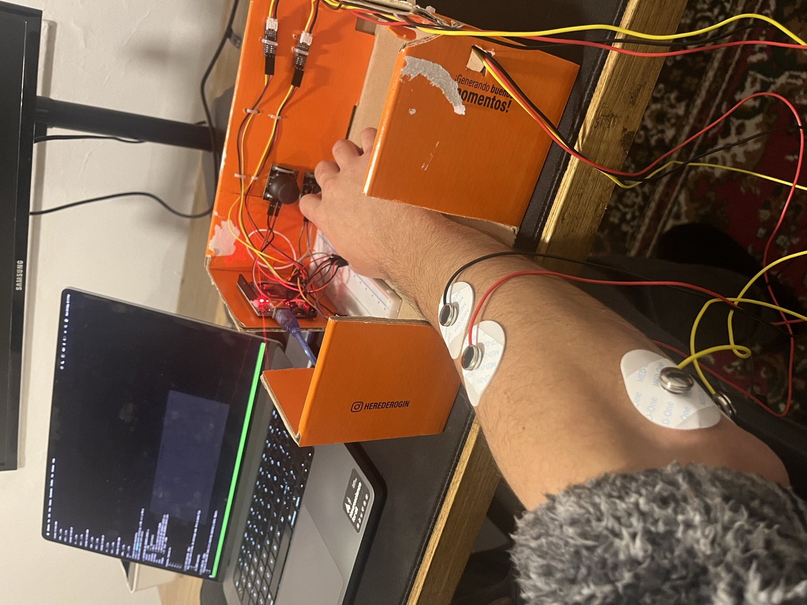

# EMG Finger-Movement Decoding

An independent research-engineering project that decodes continuous index-finger movement from two surface-EMG channels. I built the acquisition rig, recorded the dataset, implemented the signal-processing pipeline and trained a causal temporal convolutional network (TCN).

**Portfolio case study:** [EMG-based continuous movement decoding](https://gonzalospina.com/projects/emg-continous-decoding.html)



## Scope and status

This repository documents the **working Arduino Uno prototype**:

- Two single-ended surface-EMG channels: index-finger extensor and flexor.
- Two spring-loaded joysticks used only to measure index-finger position during supervised collection.
- Arduino Uno acquisition at approximately 606 Hz, with a binary serial protocol and CRC-8.
- A causal EMG feature pipeline and TCN that predicts finger velocity; the online visualizer integrates that prediction into a position display.

The later ESP32-S3 + ADS1256 / four-channel branch is exploratory and is **not** a working result or part of the reported evaluation. See [Project status](docs/PROJECT_STATUS.md).

## Research question

Can a small causal neural model predict continuous index-finger movement from surface EMG collected with a low-cost, self-built acquisition setup?

This is a single-subject prototype, not a clinical device, a prosthesis controller, or a generalization claim across people, sessions, or electrode placements.

## Pipeline

```text
surface EMG + position joysticks
        |  Arduino Uno, ~606 Hz
        v
causal 70–300 Hz band-pass -> RMS / slow RMS and derivatives
        v
causal TCN (36,769 parameters; ~935 ms receptive field)
        v
predicted finger velocity -> leaky integration for the live position display
```

Targets are derived offline from the joystick positions after Gaussian smoothing. The smoothing is non-causal and is used only to construct training targets; EMG features and the model are causal.

## Current evidence

The current Arduino champion was trained on recorded sessions S02, S03, and S08–S14 from one subject/placement regime. Its best **within-session stratified validation holdout** is:

| Metric | Value |
| --- | ---: |
| Pooled validation R² | 0.688 |
| Validation Pearson correlation | 0.830 |
| Mean per-task R² | 0.580 |

Performance varies by task: it is strongest for fast flexion and free controlled movement, and weak for held intermediate positions. The validation examples are separated from training windows with a receptive-field gap, but they do not establish independent session-, placement-, subject-, or real-world-control generalization.

The next evaluation milestone is a locked, held-out recording session that is excluded from all model selection and evaluated with the same preprocessing and metrics.
The exact provenance and locked-session protocol are documented in [Evaluation protocol](docs/EVALUATION_PROTOCOL.md).

## Demo and figures

- The repository contains photos of the Arduino acquisition rig in [`photos/jpg/`](photos/jpg/).
- The saved-model replay can export a prediction-vs-target animation from a recorded session with `visualize.py`.
- A short live-inference demo is selected in the [demo plan](docs/DEMO_PLAN.md); the source recordings are kept outside Git until a privacy-reviewed public cut is exported.

Selected figures:

- [`plots/pred_vs_target_tasks.png`](plots/pred_vs_target_tasks.png): prediction traces by task.
- [`plots/r2_by_task.png`](plots/r2_by_task.png): task-level R².
- [`plots/training_curve.png`](plots/training_curve.png): training and validation curves.

## Reproducing the software environment

The code was developed with Python 3.10. Create an isolated environment and install the pinned scientific Python dependencies:

```bash
python -m venv .venv
source .venv/bin/activate
pip install -r requirements.txt
```

Raw recordings and trained checkpoints are intentionally excluded from Git because they are large and include personal biosignal data. Consequently, a full training reproduction requires an authorized dataset export in the documented CSV schema. The project can still be inspected, the firmware compiled, and analysis scripts reviewed without the data.

## Hardware and data collection

The Arduino firmware is at [`sketchs/arduino/arduino.ino`](sketchs/arduino/arduino.ino). It samples two EMG inputs and two joysticks at a target cadence of 606 Hz and emits fixed-size, checksummed binary frames at 1,000,000 baud.

The acquisition protocol contains rest, slow and fast flexion/extension, cycles, holds, micro-corrections, confounds from other fingers/wrist movement, and free controlled movement. Full hardware, protocol, preprocessing and model details are in [`docs/methods.md`](docs/methods.md).

## Training, replay, and evaluation

After obtaining authorized recordings under `data/raw/`, a representative training command is recorded in [`docs/methods.md`](docs/methods.md). The key entry points are:

```bash
# Train a causal one-finger TCN on one or more recordings.
python train.py --csv data/raw/P01/<session>.csv --epochs 100

# Evaluate a checkpoint by behavioral task.
python eval_by_task.py --checkpoint checkpoints/<run>/best.pt --csv data/raw/P01/<session>.csv

# Replay predictions against recorded joystick position; --save exports GIF or MP4.
python visualize.py --checkpoint checkpoints/<run>/best.pt --csv data/raw/P01/<session>.csv --save replay.mp4
```

## Repository structure

```text
collection/       acquisition protocol and serial I/O
dataset/          session loading and causal EMG preprocessing
models/           causal temporal convolutional network
sketchs/arduino/  Arduino Uno firmware
train.py          one-finger training entry point
eval_by_task.py   per-task evaluation
visualize.py      offline replay and live visualizer
docs/             methods, hardware notes, and project status
```

## Limitations

- Data come from one participant and are not a biomedical validation dataset.
- Joysticks are a measurement apparatus, not a natural finger-position ground truth; their spring force can change muscle activation.
- Electrode placement and signal amplitude matter materially; the reported model is not placement-robust.
- The online display is a visualization of decoded motion, not a closed-loop controller.
- No diagnostic, therapeutic, or prosthetic performance is claimed.

## License

No license has been selected yet. Do not reuse the code, recordings, or media without permission.
